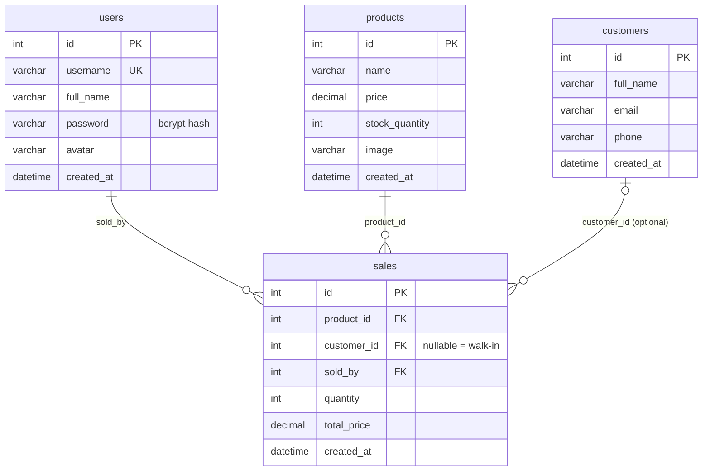

# Corner Shop POS — IT0049 Midterm Project

A complete point-of-sale system for a small sari-sari store, built with **CodeIgniter 4**.
Staff log in, record sales against a live inventory, and manage products, customers, and
other staff. Every sale takes its units out of stock and is refused when there isn't enough.

| | |
|---|---|
| **Student / Group** | _your name or group here_ |
| **Section / Professor** | _fill in_ |
| **Live site** | _paste your hosted URL here_ |
| **Repository** | _paste your GitHub URL here_ |

**Test login:** username `jcruz` · password `password123` (every seeded account uses this password).

---

## Features

- **Authentication** — session-based login/logout; every page except Home, About, and Login requires a logged-in staff member.
- **Products** — list, add, edit, delete, with an uploaded product image resized to a 300×300 display thumbnail. A product that already has sales can't be deleted (set its stock to 0 instead).
- **Customers** — full CRUD. Deleting a customer keeps their past sales, which become walk-in sales.
- **Staff** — full CRUD, avatar upload (300×300), bcrypt-hashed passwords. You can't delete yourself or a staff member who has recorded sales.
- **Record Sale** — choose a product, an optional customer, and a quantity. Stock decreases by the quantity sold; the sale is rejected with a clear message if the quantity exceeds available stock.
- **Sales History** — every transaction with product, customer (or "Walk-in"), staff member, quantity, total price, and date, plus total revenue.

## Database design



The schema follows the project brief exactly. Foreign keys on `sales` use the default `RESTRICT` behavior, so
the application checks for related sales before deleting a product or staff member, and nulls out
`customer_id` before deleting a customer.

## How a sale works

`Sales::create` validates the form, then calls `SaleModel::record()`, which runs inside one database transaction:

1. Lock the product row (`SELECT … FOR UPDATE`) so two cashiers can't sell the last unit at the same time.
2. If the quantity is more than `stock_quantity`, roll back and return a message such as *"Not enough stock: only 5 unit(s) of "Egg" available, but you asked for 8."*
3. Otherwise decrease `stock_quantity`, insert the sale (total = price **from the database** × quantity, never from the form), and commit.

## Project structure

| Path | Responsibility |
|---|---|
| `app/Config/Routes.php` | All routes; protected ones sit in one `auth`-filtered group |
| `app/Filters/AuthFilter.php` | Redirects anyone not logged in to `/login` |
| `app/Controllers/` | `Auth`, `Pages`, `Products`, `Customers`, `Users`, `Sales` — validation and flow only |
| `app/Models/` | `ProductModel`, `CustomerModel`, `UserModel`, `SaleModel` (sale transaction and history query live here) |
| `app/Libraries/ImageUploader.php` | One place for image rules, storage, resizing, and cleanup (used by products and avatars) |
| `app/Helpers/ui_helper.php` | View helpers: `peso()`, `upload_url()`, `delete_button()` |
| `app/Views/` | Templates; `layouts/` holds the shared header and footer, `products/_form.php` is shared by add and edit |
| `app/Database/Migrations/` | Creates `users`, `customers`, `products`, `sales` |
| `app/Database/Seeds/` | Sample users, customers, and products |
| `database.sql` | Full export (schema + sample data) as an alternative to migrations |

## Security

- **Authentication:** `password_hash()` / `password_verify()`; session ID regenerated at login; generic error message so usernames can't be probed; logout is a POST.
- **Access control:** a route filter guards every management and sales route, including all POST routes.
- **CSRF:** the CSRF filter is on globally, and every form carries a token (deletes and logout are POST forms, never links).
- **Validation:** server-side rules on every form (required fields, numeric ranges, unique username, valid email, existing product/customer IDs, positive whole quantities).
- **Uploads:** JPG/PNG only (extension, MIME type, and real-image check), max 2 MB, saved under a random server-side name, re-encoded and cropped through GD, and old files removed on replace/delete. `public/uploads/.htaccess` blocks script execution in that folder.
- **Output:** every value printed in a view goes through `esc()`.

## Local setup

Requirements: PHP 8.2+ with the `intl`, `mbstring`, `mysqli`, and `gd` extensions, Composer, MySQL/MariaDB.

```bash
git clone <your-repo-url>
cd <your-repo-folder>
composer install
cp env .env          # Windows: copy env .env
```

Create an empty database named `ci4pos` (utf8mb4), then edit `.env`:

```
CI_ENVIRONMENT = development
app.baseURL = 'http://localhost:8080/'
app.indexPage = ''

database.default.hostname = localhost
database.default.database = ci4pos
database.default.username = root
database.default.password =
database.default.DBDriver = MySQLi
database.default.port = 3306
```

Then **either** run the migrations and seeders:

```bash
php spark migrate
php spark db:seed DatabaseSeeder
```

**or** import `database.sql` (phpMyAdmin → Import). Don't do both on the same database.

Start the app:

```bash
php spark serve
```

Open <http://localhost:8080> and log in with `jcruz` / `password123`.

## Deployment notes

- Point the web server's document root at the **`public/`** folder (not the project root).
- Set `CI_ENVIRONMENT = production`, `app.baseURL` (with a trailing slash), and the hosting database credentials in the server's `.env`.
- Make sure `writable/` and `public/uploads/` are writable by the web server (sessions, logs, and uploaded images go there).
- Run `php spark migrate` and `php spark db:seed DatabaseSeeder`, or import `database.sql` through the host's phpMyAdmin.
- If URLs come out as `/index.php/...` and your host has no URL rewriting, remove the `app.indexPage = ''` line.

## Testing

I tested the full workflow against a real MySQL database, covering: redirects for every protected route while logged out; login success/failure and missing-CSRF rejection; recording a sale and the exact stock decrease; overselling and selling from empty stock; invalid quantities; walk-in sales; product/customer/staff add, edit, and delete (including the "has sales" protections); image upload with valid, oversized, wrong-type, and disguised-script files; password hashing and login with a new account; and logout.
